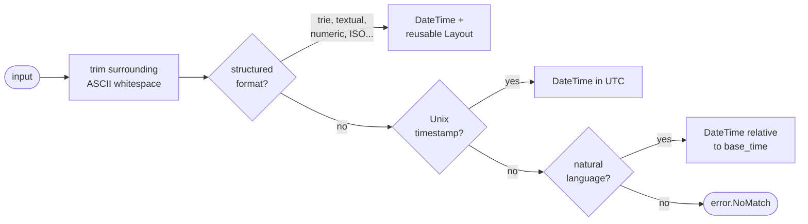

<div align="center">

# dateparsa.zig

**Date parsing for input whose format you do not control.**

CSV imports, log lines, third-party APIs, user-typed strings: dateparsa works out
the format, parses the value, and hands you a compiled layout that reads the
rest of the column with no detection and no allocation.

[](https://github.com/kmoneil/dateparsa.zig/actions/workflows/ci.yml)
[](https://ziglang.org/download/)
[](LICENSE)
[](#design)
[](#locales)
[](#how-its-checked)

</div>

```zig
const dateparsa = @import("dateparsa");

const r = try dateparsa.parse("2024-03-15T10:30:00Z");
// r.time        2024-03-15 10:30:00 +00:00
// r.layout      ISO8601_DATETIME_Z, ready to reuse on the next row
// r.ambiguous   false
```

A Zig port of [dateparsa](https://github.com/kmoneil/dateparsa) for Go, and
checked against it: every row of its golden corpus and more than 150,000
generated cases give the same answer here, byte for byte. Where the Zig version
does something differently, it is on purpose and [listed below](#differences-from-the-go-original).

## Why dateparsa

- **Detect once, parse millions.** Detection and parsing are separate problems.
  `parse` detects the format and returns a `Layout`; `layout.parse(row)` reads
  every following row with no detection at all.
- **Nothing allocates.** No function takes an allocator, because none needs one.
  Every input is bounded, so fixed buffers cover every path, not just the hot
  one.
- **Nothing reads a clock.** "3 days ago" is relative to the base time you pass,
  and an input that needs one fails with `error.NoBaseTime` rather than quietly
  using now.
- **Ambiguity is reported, never hidden.** `01/02/2024` is a guess, and the
  result says so. Strict mode refuses the guess and hands you every reading.
- **Built at comptime.** The detection trie, the 32 structured formats, the
  locale tables and the shared layouts are compile-time data in read-only
  memory: no init step, no startup cost.
- **20 locales, chosen at build time.** Month names and relative expressions in
  twenty languages. Leave out the ones you do not need with `-Dlocales`.

## Install

```sh
zig fetch --save git+https://github.com/kmoneil/dateparsa.zig#v0.3.2
```

Then in `build.zig`:

```zig
const dateparsa = b.dependency("dateparsa", .{
    .target = target,
    .optimize = optimize,
    // .locales = "fr,de",   // optional: compile in only these, English always
});
exe.root_module.addImport("dateparsa", dateparsa.module("dateparsa"));
```

Requires Zig 0.17.0. What changed in each release is in
[CHANGELOG.md](CHANGELOG.md).

## How it works



Structured detection starts with a one-pass scan that turns each byte into a
character class (`2024-03-15` becomes `DDDDSDDSDD`) and walks a comptime trie of
those signatures. What the trie cannot hold, such as month names, variable-width
numbers and fractions of any length, falls to dedicated detectors. The
format found compiles to a short instruction program, and a program whose fields
sit at fixed offsets runs as straight-line code after a single length check.

## Usage

### Reuse the detected layout

```zig
const first = try dateparsa.parse(rows[0]);
if (first.layout.reusable()) {
    for (rows[1..]) |row| {
        const t = try first.layout.parse(row); // no detection, no allocation
        // ...
    }
}
```

`reusable()` is false for two kinds of result. A Unix timestamp and "3 days ago"
have no format to reuse, so they carry layouts that refuse to re-parse. And a
format whose reading is decided per value, such as `25/12/2024` against
`01/02/2024`, still parses the next row but reads it the first row's way, so it
says it should not be cached.

What a reused layout tolerates, and what it does not:

| Row 1 | Row *n* | |
|---|---|---|
| `2024-03-15` | ` 2024-03-16\r\n` | padding is trimmed, as detection trimmed it |
| `1 May 2024` | `12 May 2024` | a one-digit day widens to two |
| `12 May 2024` | `1 May 2024` | refused: a two-digit day never narrows |
| `Fri, 15 Mar 2024 10:30:00 +0000` | `Sat, 16 Mar 2024 11:30:00 -0700` | a skipped weekday takes any letters of its width |
| `March 15, 2024` | `March 16; 2024` | refused: other skipped bytes must match |
| `March 15, 2024` | `April 16, 2024` | refused: the month is checked, never assumed |

### Parse a column

`Parser` caches the first value's layout and re-detects any value the layout
cannot answer, so the result is always what `parse` would say; only the cost
differs.

```zig
var p = dateparsa.Parser.init(.{});
for (column) |value| {
    const r = try p.parse(value); // detects once, re-detects when the format changes
    // ...
}
```

### Ambiguity

```zig
const r = try dateparsa.parse("01/02/2024");
// r.ambiguous == true: read as January 2nd, and that was a guess

const eu = try dateparsa.parseWith("01/02/2024", .{ .prefer_day_first = true });
// February 1st

var diag: dateparsa.Diagnostics = .{};
const strict = dateparsa.parseWith("01/02/2024", .{ .strict = true, .diagnostics = &diag });
// error.Ambiguous, and diag.slice() holds both readings:
//   "MM/DD/YYYY"  2024-01-02
//   "DD/MM/YYYY"  2024-02-01
```

The rules, in order:

1. **Where the year sits.** A part over 31 or of four digits is the year. A
   leading year settles the rest (`70/01/02` is 2 January 1970), because nothing
   writes `YY/DD/MM`.
2. **Value range.** A part over 12 is the day: `13/01/2024` is unambiguous.
3. **Separator.** A dot means day first: `03.02.2024` is 3 February.
4. **Preference.** `prefer_day_first`, and `prefer_year_first` for three small
   parts (`01/02/03` is 2001-02-03 with it).
5. **Report.** Whatever a preference decided is flagged `ambiguous`.

Three small parts have three readings (`01/02/03`), and a trailing two-digit
year can also be a leading one: `31/12/24` is also 24 December 2031. A month
name beside a bare number asks the same kind of question: `March 15` is the
15th or March 2015, and `01MAY10` is 1 May 2010 or 10 May 2001. Strict mode
offers every reading that is a real date, the preferred one first.

### Settle a column's order

One value often cannot say which part is the month: `01/02/2024` reads either
way, and `parse` takes the preferences' guess. A column usually can. One
`13/02/2024` anywhere in it means day first for all of it.

```zig
const column = [_][]const u8{ "01/02/2024", "05/06/2024", "13/02/2024", "03/04/2024" };
const report = dateparsa.detectColumn(&column, .{});
// report.order        .day_first
// report.settled_by   2, the index of "13/02/2024"
// report.conflicts    0

var p = dateparsa.Parser.init(report.options); // prefer_day_first is set
const first = try p.parse(column[0]); // the 1st of February
```

When nothing in the column settles it, `report.order` is null and
`report.fits` says which orders are left. When values contradict each other
(`13/02/2024` beside `02/13/2024`), it is the order the fewest contradict, and
`conflicts` and `first_conflict` say how many and where. Two-digit years narrow
it together: `13/02/03` is day first or year first, `05/06/31` month first or
day first, and the two leave only day first. ISO dates, month names, timestamps
and words have no say. `Column` does the same one value at a time, for a column
you stream, keeping only counts.

### Hand the format to another tool

A detected layout can be spelled as the format string another tool takes:
strftime (C, Python, pandas, Ruby), Go's reference time, or Java's
`DateTimeFormatter` (Java, Kotlin, Spark). Detect once, then pass the format to
whatever reads the column next.

```zig
const sample = "13/02/2024 10:30";
const r = try dateparsa.parse(sample);
var buf: [128]u8 = undefined;
var w: std.Io.Writer = .fixed(&buf);
try r.layout.formatString(.strftime, sample, &w); // %d/%m/%Y %H:%M
// .go gives 02/01/2006 15:04, .java gives dd/MM/yyyy HH:mm
```

Pass the value the layout was detected from: a layout keeps no input bytes, and
the string spells that value's separators and words. A field a dialect cannot
spell is `error.Unsupported`, never a string that reads something else: an
ordinal suffix (`23rd`) in any dialect, an ISO week date outside strftime, a
fraction past microseconds or a zone name other than UTC or GMT in strftime.
`tools/format_check.sh` parses every example in the format table with the
string each dialect gets, in Python, Go and Java, and checks they read what
dateparsa read.

### Natural language

```zig
const base: dateparsa.DateTime = .{ .year = 2024, .month = 3, .day = 15, .hour = 12 };

const r = try dateparsa.parseWith("next friday at 5pm", .{ .base_time = base });
// 2024-03-22 17:00:00, r.kind == .relative

// No base time means no guess at "now": the library never reads a clock.
_ = dateparsa.parse("3 days ago"); // error.NoBaseTime
```

`now`, `today`, `tonight`, `yesterday at 5pm`, `3 days ago`, `in 2 hours`,
`a week from now`, `2 days and 3 hours ago`, `half an hour ago`, `next friday`,
`last month`, `this morning`, `end of month`, `beginning of year`, `March 5`, and
their counterparts in each configured locale. Month and year arithmetic clamps
to the end of the month: one month before 2024-03-31 is 2024-02-29.

### Locales

```zig
const opts: dateparsa.Options = .{ .base_time = base, .locales = .{ .fr = true, .de = true } };
const fr = try dateparsa.parseWith("15 mars 2024", opts);
const de = try dateparsa.parseWith("vor 3 Tagen", opts);

// Or by BCP 47 tag, when the tag arrives at run time.
const es = dateparsa.localeSet("es-MX") orelse return error.NotCompiledIn;
const r = try dateparsa.parseWith("hace 2 horas", .{ .base_time = base, .locales = es });
```

Arabic, Chinese, Danish, Dutch, English, Finnish, French, German, Hindi,
Italian, Japanese, Korean, Norwegian, Polish, Portuguese, Russian, Spanish,
Swedish, Turkish and Ukrainian, generated from the Go library's CLDR-derived
tables. English is always read; the others are read when `Options.locales`
names them. Hindi कल means both yesterday and tomorrow, and the result says it
is ambiguous.

`-Dlocales=fr,de` compiles in only the locales named. The others' data never
reaches your binary, and a set naming one is a compile error rather than a
silent miss:

```
error: no field named 'es' in struct 'locale.LocaleSet__struct_...'
```

### Zones and timestamps

```zig
// An input that writes no zone is read at timezone_offset (seconds east).
const ist = try dateparsa.parseWith("2024-03-15 10:30:00", .{ .timezone_offset = 5 * 3600 + 30 * 60 });
const instant = ist.time.toEpoch(); // seconds since 1970-01-01T00:00:00Z

// Unix timestamps: the digit count is the precision.
const ms = try dateparsa.parse("1710504800123"); // milliseconds
```

Offsets are fixed: `Z`, `+05:30`, `-0800`, `+00`, and sixteen abbreviations
(`UTC`, `GMT`, `EST`, `CET` and so on) each read as the offset it names.

### JSON

`FlexTime` is a field type for `std.json`. It reads a time however the document
writes it and writes it back as RFC 3339:

```zig
const Event = struct { name: []const u8, at: dateparsa.FlexTime };

const events = try std.json.parseFromSliceLeaky([]Event, arena,
    \\[{"name": "a", "at": "March 15, 2024"},
    \\ {"name": "b", "at": 1710505800123},
    \\ {"name": "c", "at": null}]
, .{});
// events[0].at.time   2024-03-15 00:00:00 +00:00
// events[1].at.time   2024-03-15 12:30:00.123 +00:00
// events[2].at.time   null

const out = try std.json.Stringify.valueAlloc(arena, events[1], .{});
// {"name":"b","at":"2024-03-15T12:30:00.123Z"}
```

A string is read as `parse` reads it, and `at.ambiguous` says when it needed a
guess. A number is a Unix timestamp whose digit count is its precision, and
under ten digits it is seconds: `86400` is 2 January 1970, while the string
`"86400"` is refused. Outside `std.json`, `FlexTime.fromValue` reads the same
values from a database row or anything else already typed, and
`FlexTime.fromValueWith(&parser, value)` reads strings with your `Options`,
strict mode included.

### From the command line

`dateparsa detect` says how a column is written, and `dateparsa normalize`
writes it back as RFC 3339:

```console
$ cat orders.csv
id,ordered_at,total
1,03/02/2024 09:15,12.50
2,14/02/2024 17:40,8.00
3,,3.20
4,TBD,4.75

$ dateparsa detect orders.csv --col ordered_at
values     3, and 1 empty
read       2
not read   1
           line 5: "TBD"
order      day first, settled by line 3: "14/02/2024 17:40"
ambiguous  1, read day first as the column settles

values  example           strftime        go                java
     2  03/02/2024 09:15  %d/%m/%Y %H:%M  02/01/2006 15:04  dd/MM/yyyy HH:mm

$ dateparsa normalize orders.csv --col ordered_at
id,ordered_at,total
1,2024-02-03T09:15:00Z,12.50
2,2024-02-14T17:40:00Z,8.00
3,,3.20
4,TBD,4.75
dateparsa: 1 value not read, left as it was:
  line 5: "TBD"
```

`--col` takes a column's number, from 1, or its name in the header. A file is
read as CSV when `--col` is given (quoted fields, line breaks inside quotes,
`-d ';'` or `-d tab` for other separators) and as one value a line when it is
not. With no file, standard input is read. `normalize` changes only the
column's bytes: every other field, the quoting, the line endings and the byte
order mark are written back as they were read, and a value it cannot read is
left as it was and listed on standard error.

The date order is settled from the whole column before the first value is
written, so `03/02/2024` on line 2 is read day first because of line 3. That
means two passes: a file is read twice, and standard input is held in memory.
Where nothing in the column settles the order, `normalize` refuses to guess
and asks for `--order day-first` (or `month-first`, `year-first`), which also
lets it stream standard input in one pass. `detect --json` writes the report
for a script, and both exit 0 when every value was read, 1 when some were not
or the order is not settled, and 2 on a usage or input error.

`--base now` (or any date and time) reads relative dates and dates with no
year, `--tz +05:30` is the offset of values that write no zone, `--utc` writes
every time in UTC, and `--locale fr,de` reads month names in more languages.
`dateparsa --help` lists it all.

Each [release](https://github.com/kmoneil/dateparsa.zig/releases) archive
holds the command in `bin/` (`dateparsa.exe` on Windows), a single static
executable on Linux. To build it yourself, `zig build -Doptimize=ReleaseSafe`
puts it in `zig-out/bin`.

### From Python

```sh
pip install dateparsa
```

```python
import dateparsa

r = dateparsa.parse("13/02/2024 10:30")
r.datetime                    # datetime(2024, 2, 13, 10, 30, tzinfo=timezone.utc)
r.layout.format_string()      # '%d/%m/%Y %H:%M', for pandas
dateparsa.detect_column(["01/02/2024", "13/02/2024"]).order   # 'day_first'
```

Wheels for Linux (glibc and musl), macOS 13 and later, and Windows, on x86_64
and arm64, for Python 3.9 and later: the release libraries below behind a
`ctypes` binding, so nothing compiles on install. Every release installs each
wheel on its own platform and runs the Python tests against it first.
[python/README.md](python/README.md) has the rest.

### From C and other languages

Each [release](https://github.com/kmoneil/dateparsa.zig/releases) attaches
`libdateparsa` for Linux, macOS (13 and later) and Windows, on x86_64 and
arm64: one archive per platform holding the static and the shared library, the
header [`include/dateparsa.h`](include/dateparsa.h), the `dateparsa` command
and the licences, with
`SHA256SUMS` and build provenance (`gh attestation verify <archive> --repo
kmoneil/dateparsa.zig`). On Windows the DLL's import library is
`dateparsa.lib` and the static library `dateparsa_static.lib`. To build it
yourself, `zig build lib` puts the library (static, or shared with
`-Dlinkage=dynamic`) in `zig-out/lib` and the header in `zig-out/include`.
Anything that can call C can use it: Python through `ctypes`, Rust, Go through
cgo, Swift, C#.

```c
#include "dateparsa.h"

dateparsa_result r;
if (dateparsa_parse("2024-03-15 10:30:00", 19, NULL, &r) == DATEPARSA_OK) {
    // r.time.year 2024, r.unix_seconds 1710498600, "%.*s" of r.label: SQL_DATETIME
    dateparsa_datetime next;
    if (r.reusable)
        dateparsa_layout_parse(&r.layout, "2024-04-20 08:00:00", 19, &next); // no detection
}
```

It is the same library and keeps the same promises: nothing allocates, every
struct is yours, and a zeroed `dateparsa_options` is the default. Strings go in
as pointer and length; the labels and messages that come back are static and
not NUL-terminated. `dateparsa_parser` is the column cache,
`dateparsa_column` settles a column's order, `dateparsa_format_string` spells a
layout for strftime, Go or Java, and `dateparsa_layout`, the reusable format,
copies like any struct. What a C
caller passes in is checked rather than trusted: a base time that is no date,
an offset of a day or more, a locale bit the build left out, a `NULL` where a
pointer is needed, or a layout the library never filled in is
`DATEPARSA_INVALID_ARGUMENT`, and `diagnostics.message` says which. Building
it yourself, use `-Doptimize=ReleaseFast` for speed and `-Dtarget` for the
oldest system you ship to, such as `-Dtarget=aarch64-macos.13.0`.

## Formats

| Family | Examples |
|---|---|
| ISO 8601 / RFC 3339 | `2024-03-15` · `2024-03-15T10:30:00Z` · `2024-03-15T10:30:00.123456+05:30` · `2024-W11-5` · `2024-074` · `2020-07-20+08:00` |
| SQL and logs | `2024-03-15 10:30:00` · `2024-03-15 10:30:00.000000` · `2024-03-15 10:30:00+00` · `2014-12-16 06:20:00 UTC` · `2014-05-11 08:20:13,787` |
| Compact | `20240315` · `20240315T103000Z` · `20240315103000` · `171113` |
| Numeric | `03/15/2024` · `15.03.2024` · `3/15/24` · `3/15/2024 10:30 PM` |
| Textual | `March 15, 2024` · `15 Mar 2024` · `December 23rd` · `March 2024` · `the 15th of March 2024` |
| RFC 2822, 850, ANSI C | `Fri, 15 Mar 2024 10:30:00 +0000` · `Friday, 15-Mar-24 10:30:00 UTC` · `Mon Jan 2 15:04:05 2006` |
| Elsewhere | `15/Mar/2024:10:30:00 +0000` (CLF) · `Fri Jul 03 2015 18:04:07 GMT+0100` (JavaScript) · `2015-02-08 03:02:00 +0300 MSK` (Go) · `2014:04:08 22:05:13` (EXIF) · `2014年04月08日` |
| Times | `10:30` · `10:30:00` · `10:30 PM` · `10:30:00.123` |
| Timestamps | `1710504800` · `1710504800123` · `1710504800123456` · `1710504800.123` |

A time with no date takes 1 January of the base time's year, and a date with no
time is midnight. Validation refuses rather than normalises: `2024-02-30` is
`error.NoMatch`, never 1 March.

## Design

- **No allocation.** No API takes an allocator, apart from `FlexTime`'s
  `std.json` hooks, which are handed `std.json`'s: it uses it to unescape a
  string, and the hook frees that copy before returning. Inputs are bounded (a
  format addresses at most 510 bytes, a natural-language expression 512), so
  fixed buffers serve every path.
- **No hidden I/O.** The library reads no clock, file, environment or network.
- **Values, not pointers.** `Layout` and `DateTime` are plain values you can
  copy, store and compare.
- **Thread safety.** Everything is immutable except `Parser`'s cache: use one
  `Parser` per thread, or share layouts, which are read-only. `FlexTime` keeps
  its caches per thread.
- **Comptime data.** Trie, formats, compiled layouts, locale tables and the
  Unicode case tables the natural-language scanner uses are all built at
  compile time.

## Differences from the Go original

Each is deliberate.

| Go | Zig |
|---|---|
| A missing base time means `time.Now()` | `error.NoBaseTime`, only for input some base time would read |
| `*time.Location` with daylight-saving rules | Fixed UTC offsets (`timezone_offset`), abbreviations as fixed offsets |
| `GoLayout()` and `Compile` from Go layout strings | Not ported: there is no `time.Parse` to interoperate with |
| `ParseColumn` | `Parser.parse` in your own loop |
| Error structs with formatted messages | An error set plus optional `Diagnostics`; no input bytes are copied |
| Natural-language readings labelled with their dates | Labelled `NATURAL_LANGUAGE`; the times tell them apart |
| A reused layout folds month names with Unicode case rules | ASCII case, as detection already does ([kmoneil/dateparsa#36](https://github.com/kmoneil/dateparsa/issues/36)) |
| All locales always linked | Chosen at build time with `-Dlocales` |
| `flextime`: `database/sql`, JSON and text (un)marshalling, `WithJSONFormat`, layout caches shared by the process | `FlexTime`: `std.json` hooks and `fromValue`, always RFC 3339 out, caches per thread |

## How it's checked

| Check | What it covers |
|---|---|
| `zig build test` | The full suite, including every row of the Go library's golden corpus (`testdata/golden.txt`, 1,377 inputs) and every example in this README, format table included |
| `tools/oracle.sh` | Runs the Go library and this port side by side: 33,186 public-API answers under nine option sets, including a first row's layout reused on 3,522 other rows, and 124,068 natural-language answers across every locale. All identical. |
| `tools/fuzz.sh` | Zig's fuzzer on eight properties: any bytes parse without tripping a safety check, to a time that round-trips through RFC 3339 and that the result's layout re-reads, and whose format string in every dialect is spelled or refused; a layout reused on another input refuses it or agrees with detection; a primed `Parser` agrees with `parseWith`; the fast path agrees with the interpreter; any JSON `FlexTime` reads is a valid time whose RFC 3339 reads back to it; `FlexTime`'s caches agree with cold ones; each field order a column's values are said to fit is the order their preferences read, and a column's options read every value that fits its order in it; and the C API refuses exactly the options it must, whatever a C struct holds, and otherwise answers as `parseWith` does. `zig build test` replays their seeds: the Go library's fuzz seeds and crashers, the golden corpus and every format's example |
| CI | Every pull request runs formatting, zigvet and `zig build test` on Linux, macOS and Windows, in every optimize mode, and with only `en` or only `fr,de` compiled in. The fuzzer runs 50K times a target after each merge and 10M a night, from a corpus kept between runs; a find opens an issue |
| C API | `zig build test` also checks `include/dateparsa.h` against the exports field by field, calls through the header on every golden row under five option sets and down the corpus with a parser, runs `test/c_api.c` against the static library on every platform CI covers, and compiles the header as C++ |
| The command | `zig build test` runs the `dateparsa` command on CSV and line input, through every message it writes, and runs the built binary on a file and on standard input; each release runs its own prebuilt binary on Linux, macOS and Windows before publishing |
| `tools/format_check.sh` | Every example in the format table, and variants of it, parsed with the format string each dialect gets, by Python's `strptime`, Go's `time.Parse` and Java's `DateTimeFormatter`: 155 format strings, each reading the fields it sets as dateparsa does |
| Unicode tables | Lowercasing and word boundaries match Go's `unicode` package on all 1,114,112 code points |
| Deliberate breaks | Each feature's tests were run against seeded bugs, and every bug that could change an answer was caught |

## Performance

Measured against the Go library on one machine, by the Go library's own
benchmarks: reusing a layout takes 0.6 to 0.8 of Go's time, natural language
0.3 to 0.5, a miss 0.2 to 0.8 and a textual date 0.5 to 0.6, and the first
parse of the other structured formats is at or near Go's.

Against other parsers on the same machine: a reused layout reads ISO 8601
and RFC 3339 in 0.6 to 0.8 of zeit's time, and through the C interface
Rust's fastest parsers, told the format, take 0.4 to 0.9 of a layout's time.
Working the format out, dateparsa is faster than Rust's dateparser on all but
RFC 3339, RFC 2822 and a non-date. From Python it is 6 to 14 times as fast as
dateutil's `parse`, 140 to 810 times as fast as dateparser, and faster than
`strptime` is when told the format, though the binding still costs about ten
times what the parse does.

[docs/PERF.md](docs/PERF.md) has the tables, how they are measured, and why
a number from them means nothing on another machine.

## Development

```sh
zig build test          # unit, golden corpus and README tests
zig build fmt-check     # formatting
zig build vet           # zigvet, github.com/kmoneil/zigvet
zig build docs          # API documentation into zig-out/docs
zig build run -- detect FILE --col N   # the dateparsa command, built and run
zig build lib           # libdateparsa and its C header into zig-out (-Dlinkage=dynamic)
tools/dist.sh           # every release platform's library, archived into zig-out/dist
tools/format_check.sh   # format strings, parsed by Python, Go and Java (needs all three)
python3 -I tools/python_wheels.py   # after tools/dist.sh: the wheels, into zig-out/wheels
zig build fuzz          # replay the fuzz seeds alone
zig build bench         # the benchmarks (-- -bench NAME -count N -benchtime MS)
tools/bench.sh          # against the Go library, on this machine (needs go)
tools/bench_others.sh   # against parsers in Zig, Rust and Python (needs cargo and uv)
tools/fuzz.sh [LIMIT]   # fuzz them, LIMIT runs each (default 1M), failing on a find
zig build locales       # regenerate src/locale/ from the Go repository's tables
zig build unicode       # regenerate src/unicode_data.zig (needs go)
tools/oracle.sh         # diff against the Go library (needs go and a Go checkout)
```

The Python tests run against an installed wheel, or against a library you
built:

```sh
zig build lib -Dlinkage=dynamic
DATEPARSA_LIB=zig-out/lib/libdateparsa.dylib PYTHONPATH=python/src python3 -m unittest discover -s python/tests
```

## License

Apache-2.0, see [LICENSE](LICENSE). The locale data is derived from the Unicode
CLDR and carries the Unicode License v3, reproduced in [NOTICE](NOTICE).
